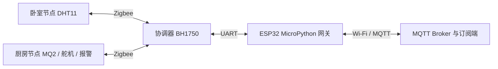

# CC2530 Zigbee 室内环境监测

大学课程设计：用三个 CC2530 节点组成室内传感网络，通过 ESP32 网关将数据转发到 MQTT，并接收控制指令。

> 状态：历史课设。保留 CC2530 应用层工程与 ESP32 MicroPython 脚本；完整 TI Z-Stack SDK、硬件环境和历史工具链未随仓库提供，本次未重新构建或进行实机验证。

## 系统组成

| 部分 | 源码体现的职责 |
| --- | --- |
| CC2530 协调器 | 管理节点信息与心跳，采集 BH1750 光照，汇总数据后通过串口发送 |
| 卧室节点 | 采集 DHT11 温湿度，发送状态并处理控制指令 |
| 厨房节点 | 采集 MQ2 数值，驱动报警与舵机相关控制 |
| ESP32 网关 | 将串口数据发布到 MQTT `/ESP32`，把 `/WECHAT` 收到的消息转发至串口 |

ESP32 脚本还读取 GPIO25 上的 DHT11，将网关本地温湿度附加到上行消息。

## 文件导航

| 路径 | 用途 |
| --- | --- |
| [GenericApp.eww](CC2530/CC2530DB/GenericApp.eww) | IAR 工作区入口 |
| [GenericApp.ewp](CC2530/CC2530DB/GenericApp.ewp) | IAR 工程与三种构建配置 |
| [Coordinator.c](CC2530/Source/Coordinator.c) | 协调器逻辑 |
| [bedroom.c](CC2530/Source/bedroom.c) | 卧室节点逻辑 |
| [kitchen.c](CC2530/Source/kitchen.c) | 厨房节点逻辑 |
| [Source/IO/](CC2530/Source/IO/) | DHT11、BH1750、MQ2、舵机与 IO 驱动 |
| [smartHome.h](CC2530/Source/smartHome.h) | 应用 Profile、Endpoint 和命令 ID |
| [sapi.c](CC2530/Source/sapi.c) | Z-Stack Simple API 相关代码 |
| [main.py](main.py) | ESP32 MicroPython 网关入口 |

## 工程打开方式

### CC2530

1. 准备 IAR Embedded Workbench for 8051，以及与原工程匹配的 TI Z-Stack SDK。
2. 根据 `GenericApp.ewp` 的相对路径恢复 SDK 布局。工程引用了仓库之外的 `Components` 等目录，单独克隆本仓库无法完成构建。
3. 打开 `GenericApp.eww`，按节点选择 `CoordinatorEB`、`Bedroom` 或 `Kitchen` 配置。
4. 核对芯片、引脚、时钟和 SDK 编译选项后再构建。原工具链与 SDK 的确切版本尚未确认，已有输出文件不能证明环境可复现。

### ESP32 网关

需要支持 `machine`、`network`、`dht` 与 `umqtt.simple` 的 MicroPython 环境。先检查 `main.py` 中的 Wi-Fi / MQTT 连接配置，再核对串口与传感器接线。

| 配置 | 当前脚本值 |
| --- | --- |
| UART | `UART(2)`，`115200` 波特率 |
| 引脚 | RX = GPIO12，TX = GPIO13 |
| 串口格式 | `bits=8, parity=0, stop=1`，需与协调器配置核对 |
| 网关 DHT11 | GPIO25 |
| 上行 / 下行主题 | `/ESP32` / `/WECHAT` |

普通桌面 Python 无法直接运行该脚本。MQTT Broker、订阅端界面与完整部署环境不包含在仓库中。

## 使用边界

- 这是自定义应用协议实验，源码使用 Profile ID `0x0501` 和自定义命令，不能据此认定可直接接入通用 Zigbee 智能家居网关。
- MQ2 阈值与控制策略是课设逻辑，没有标定或安全认证证据，不可作为烟雾报警产品的设计依据。
- 部分源码采用历史中文编码；出现乱码时应选择匹配编码，避免无意批量转码。
- 原 `Exe`、`Obj`、`List` 和 IDE 临时状态已停止跟踪，应用源码与工程配置保留。历史构建文件不构成本次验证结果。

## 历史实物

图片来自原 README，记录当时的硬件搭建。

## 来源与维护

保留大学时期的嵌入式与无线组网实践。目前没有项目级 LICENSE；TI SDK 相关文件与其他第三方组件继续遵循各自权利声明。
